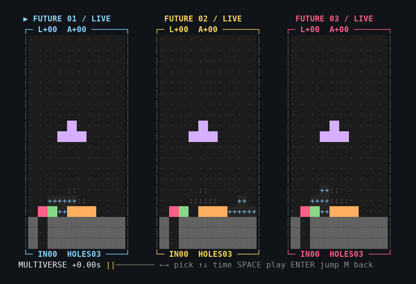
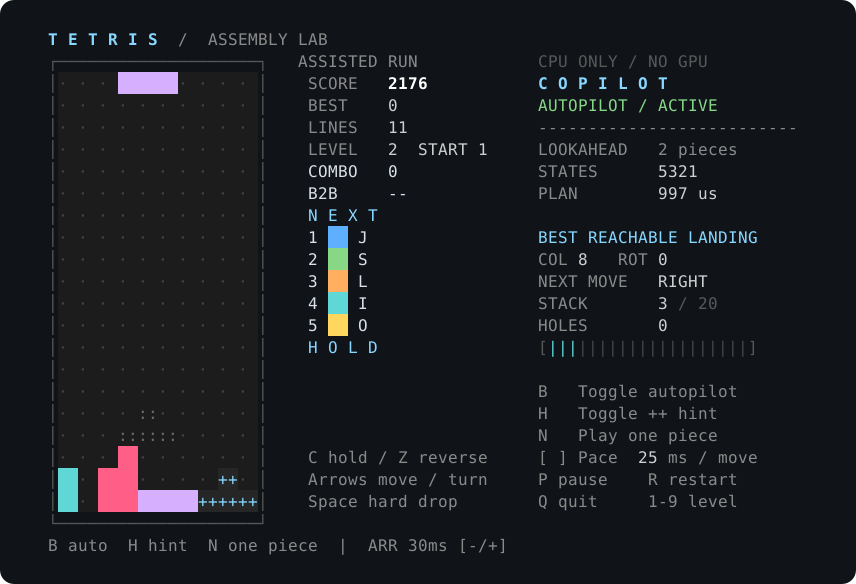
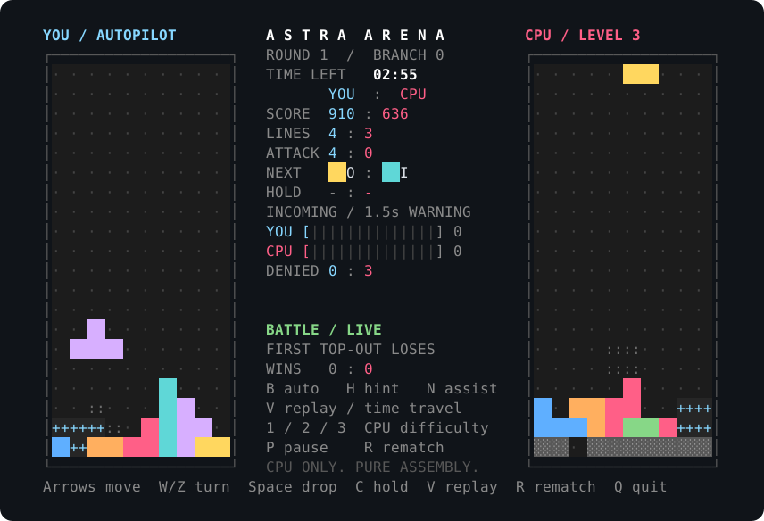

# ASTRA MULTIVERSE / Assembly Tetris

A complete, playable terminal Tetris written entirely in NASM x86-64 assembly,
with a CPU copilot, a two-player battle arena with time travel, and a
"multiverse" that simulates three possible futures you can jump into.

The ELF starts at `_start`, links without libc or any language runtime, and
talks to Linux only through direct system calls. Everything runs on one CPU
thread: no GPU, model download, API key, or network connection.



**Highlights**

- **Modern Tetris engine** — full SRS wall kicks, 7-bag randomizer, hold,
  5-piece preview, ghost piece, lock delay, T-spins, combos, back-to-back and
  perfect-clear scoring.
- **Solo copilot** — breadth-first route search with two-piece lookahead,
  live hints, animated autopilot, and reproducible headless benchmarks.
- **Battle arena** — you or a CPU against a CPU, with garbage attacks and a
  replay timeline you can rewind and branch from.
- **Multiverse** — three counterfactual futures, eight seconds ahead, shown
  side by side; pick any living frame and continue playing from it.
- **Deterministic JSON tools** — benchmarks, matches, and forecasts reproduce
  exactly from a seed.
- **About 95 KiB**, statically linked, with debug symbols included.

## Contents

- [Quick start](#quick-start)
- [Game modes](#game-modes)
  - [Solo with copilot](#solo-with-copilot)
  - [Battle arena and replay](#battle-arena-and-replay)
  - [Multiverse](#multiverse)
- [Controls](#controls)
- [Command line](#command-line)
- [Testing](#testing)
- [How it works](#how-it-works)
- [Source layout](#source-layout)
- [Debugging](#debugging)

## Quick start

**Requirements:** Linux x86-64, NASM, GNU `ld`, `make`, and an ANSI/VT
interactive terminal. UTF-8 and 256-color support give the intended look.
Python 3 is optional and only needed for the integration tests.

```sh
sudo apt install nasm make binutils   # Ubuntu / Debian
make
./tetris
```

Then try the other modes:

| Command | What it does |
|---|---|
| `./tetris` | Solo game |
| `make demo` | Solo game with the copilot playing; press a move key to take over |
| `make versus` | You vs the CPU |
| `make showcase` | CPU vs CPU; take over with a movement key |
| `make magic` | Start directly in the multiverse |

Terminal size: the solo dashboard and every two-player view need
**80 × 24**. Solo also has a compact view down to 60 columns. Smaller windows
suspend play until resized, without costing you game time.

Remove build products with `make clean`.

## Game modes

### Solo with copilot



The solo game includes a CPU-only copilot. By default it shows its
recommended landing as a cyan `++`; the darker `::` ghost is still where your
own hard drop would land. The dashboard shows search size, decision time, the
copilot's next action, stack height, and buried holes.

- **B** toggles animated autopilot.
- **N** lets the copilot play just the current piece, then hands control back.
- **H** toggles the hint.
- Any move, rotation, drop, or hold takes control back immediately.

Once the copilot has moved a piece, that run is marked *assisted* and cannot
set the saved human high score. Restart with autopilot off for a fresh human
run. The high score is kept in `.tetris_highscore` in the current directory.

### Battle arena and replay



Two boards, a seeded piece stream shared by both players, a three-second
countdown, and garbage attacks. The first player to top out loses. After three
minutes, whoever sent more attack rows wins; cleared lines break a tie.

The CPU opponent uses the copilot's reachable-move planner, with 175, 100, or
50 ms between actions at difficulty 1, 2, or 3. Gravity and lock delay apply
to both players. On your side, a movement key takes control back from your
pilot; **B** toggles it, **H** enables hints, and **N** delegates the current
piece. Arena scores are kept separate from the solo high score.

#### Attack rules

The arena uses an aggressive custom attack table:

| Clear | Outgoing rows |
|---|---:|
| Single | 1 |
| Double | 2 |
| Triple | 4 |
| Four lines | 6 |
| Full T-spin | 2 per cleared line |
| T-spin mini | 1 per cleared line |

- A back-to-back difficult clear adds 1 row; combos add up to 5; a perfect
  clear adds 6.
- Outgoing attacks first cancel your oldest incoming rows.
- Surviving rows arrive with a **1.5-second warning**; the incoming meter
  turns amber when rows are ready.
- A lock that clears no lines raises up to eight ready garbage rows, so
  clearing lines buys time. Each garbage row is grey with one hole.
- Each tick advances both players before delivering attacks, so neither side
  gets an advantage from its engine running first.

#### Replay and branching

Press **V** during a battle to open roughly the last 16 seconds of replay.
Scrub with **Left / Right**, play or pause with **Space**, then press
**Enter** to resume the match from that moment and change its future. **V**
returns to the untouched live match instead.

Replay stores **complete game states** — both boards, current pieces, next
queues, 7-piece bags, random streams, hold slots, AI routes, lock timers, and
incoming garbage — in a 128-entry ring recorded about every 125 ms. The live
match stays frozen while you watch. Branching restores the selected state and
discards its old future; if you branch back into a finished round, that
round's win is undone. Select a frame before the top-out to resume.

The arena runs on a virtual clock: pausing, a too-small window, and viewing
replay consume no match time.

### Multiverse

**Watch three possible futures. Pick one. Jump into it.**

```sh
make magic                 # uses the default seed, 12648430
./tetris --multiverse 2026
```

The showcase first plays 30 seconds of a real seeded battle without waiting
(stopping earlier at the last living position if the match would end). It
then simulates three complete battles **eight seconds** into the future and
lets you scrub through their timelines side by side. During any live or paused
arena match, press **M** to forecast from your current position.

[Full-resolution terminal still](docs/multiverse.svg). The animation above is
recorded from the executable, including the jump into future 03.

Each board shows, at the cursor:

| Label | Meaning |
|---|---|
| **L+** | Extra lines cleared |
| **A+** | Extra attack rows sent |
| **IN** | Pending incoming rows |
| **HOLES** | Buried holes |

Counters saturate at 99. All three boards fit in 80 × 24. Playback loops at
twice real speed and holds the final frame briefly so you can compare
outcomes.

**How the futures are made.** The three branches start from different
reachable placements ranked by the two-piece planner. Each branch then runs
the same copilot and game engine in 25 ms steps — gravity, the opponent,
attack cancellation, and delayed garbage included. The forecasts assume the
copilot controls your pieces, so they are counterfactual simulations under
that policy: human moves and real-time scheduling can change what follows. The
boards show your side, but every frame contains the opponent too.

For example, seed **2026** projects **2, 5, and 8** extra outgoing attack
rows, with **0, 1, and 4** holes after eight seconds: more offense comes with
a messier stack. Local runs calculated all three futures in about
70–170 ms; timing depends on the CPU and its load.

**Jumping** restores the exact chosen state, including both piece streams,
garbage randomness, AI paths, deadlines, and queues. The branch's recorded
frames become your new replay history, which **V** can revisit.

- A completed future is marked **ENDED**; scrub to an earlier living frame
  before jumping.
- Tight positions with fewer reachable moves show fewer futures.
- If no legal landing exists, the match stays as it is.
- Forecasting never changes the original match or the saved high score.

## Controls

### Solo

| Key | Action |
|---|---|
| Left / `A` | Move left |
| Right / `D` | Move right |
| Down / `S` | Soft drop |
| Up / `W` | Rotate clockwise |
| `Z` | Rotate counter-clockwise |
| Space | Hard drop and lock |
| `C` | Hold / swap piece (once per lock) |
| `B` | Toggle animated autopilot |
| `H` | Toggle the recommended landing (`++`, on by default) |
| `N` | Let the copilot play this piece, then return control |
| `[` / `]` | Slow down / speed up copilot moves (25–250 ms) |
| `-` / `+` | Slow down / speed up horizontal auto-repeat (15–90 ms) |
| `P` | Pause / resume |
| `R` | Restart |
| `1`–`9` | Restart at that starting level |
| `Q` or Ctrl+C | Quit |

### Battle arena

Piece controls and **B / H / N** work as in solo. Additionally:

| Key | Action |
|---|---|
| `V` | Enter replay / return to the live match |
| Left / Right | Scrub replay |
| Space | Play / pause the replay |
| Enter | Branch: resume the match from the selected frame |
| `M` | Open the multiverse from the current position |
| `P` | Pause both boards |
| `1` / `2` / `3` | Opponent difficulty |
| `R` / `Q` | Rematch / quit |

### Multiverse

| Key | Action |
|---|---|
| Left / Right, or `1` / `2` / `3` | Choose a future |
| Up / Down, or `]` / `[` | Seek forward / backward by 125 ms |
| Space or `P` | Play / pause all three timelines |
| Enter | Jump into the selected frame, with both players restored |
| `M` | Return to the original, untouched match |
| `R` / `Q` | Rematch / quit |

## Command line

```text
./tetris                              Solo game
./tetris --demo                       Solo with the copilot playing
./tetris --versus [seed]              Play against the CPU
./tetris --arena-demo [seed]          Watch two CPUs battle
./tetris --multiverse [seed]          Explore three playable futures
./tetris --benchmark [pieces [seed]]  Headless copilot run, JSON
./tetris --match [seconds [seed]]     Headless battle, JSON
./tetris --forecast [seed]            Three future outcomes, JSON
./tetris --test                       Assembly self-tests
./tetris --help                       Usage summary
```

Seeds are nonzero unsigned 64-bit integers. Arguments are strictly validated.

The `make` targets wrap the same modes and accept variables:

```sh
make benchmark PIECES=1000 SEED=42
make match MATCH_SECONDS=180 SEED=2026
make forecast SEED=42
make magic SEED=2026
```

Defaults are `SEED=12648430`, `PIECES=1000`, and `MATCH_SECONDS=180`.

### Headless JSON tools

All three tools run the real engine without terminal rendering, sleeps, or
real-time gravity. Every field except the wall-clock timing field reproduces
exactly for the same arguments. None of them load or save the high score.

**`--benchmark`** executes complete copilot routes for 1–1,000,000 pieces
(default 1,000) and reports pieces, lines, score, board height, holes, search
counts, timing, a stable board hash, and a stopping reason (`limit`,
`top_out`, or `no_plan`). On an Intel Core i7-8665U, seeds 42, 2026, and
12648430 cleared 398, 399, and 399 lines in 1,000 pieces, with planning
taking about 1–2 ms per piece. Interactive play keeps gravity, so the
headless result is not a promise for every pilot speed or starting level.

**`--match`** advances the arena's virtual clock in 25 ms steps through the
same game loop and reports the result, both players' scores, attacks
sent / cancelled / received, pending rows, board hashes, and cell counts
(`wall_ms` is the only non-reproducible field). A three-minute run with seed
2026 processed 674 locked pieces and 205 outgoing attack rows in about
2.1 seconds.

**`--forecast`** reports the original match and the three branch outcomes,
including first landing IDs, scores, attacks, cell counts, and board hashes
(`build_ms` is the only non-reproducible field).

## Testing

```sh
make test     # assembly self-tests (same as ./tetris --test)
make check    # self-tests plus 14 pseudo-terminal integration tests (Python 3)
```

**Engine self-tests** cover collision (empty, wall, floor, occupied), I and
JLSTZ SRS wall kicks, delayed locking, mini/full T-spin recognition,
hold/queue behavior, simultaneous line compaction, scoring, level
progression, 7-bag uniqueness, and full-width integer conversion.

**Copilot tests** check board evaluation, search purity, a four-line well,
top-out, and high-score isolation. 120 search routes are replayed through
live physics; the landing and all 200 resulting board cells must match the
search's prediction.

**Arena tests** cover attack cancellation, delayed arrivals, garbage overflow,
bounded queues, wrapped replay history, and exact replay of a 30-second
simulated future (only wall-clock profiler bytes may differ).

**Multiverse tests** compare every byte of the original contexts, session
controls, and replay history before and after forecasting. They
independently replay all three futures and compare both complete player
contexts, time, and garbage RNG; check exact branch restoration; isolate
simulated match endings; and cover positions with one or no legal landing.

**Integration tests** drive the real executable in a pseudo-terminal:
deterministic benchmarks, strict argument parsing, fragmented arrow-key
sequences, single-piece control, pause/takeover, resizing, terminal
restoration on Q, Ctrl+C, SIGHUP, SIGINT, SIGQUIT, and SIGTERM, cell
conservation, attack accounting, output under backpressure, replay and
branching, rematches, the three-board layout, seek bounds, and that the
chosen multiverse board becomes the playable board exactly.

## How it works

### The copilot

Classical game search on a single CPU thread:

1. **Reachability.** Breadth-first search explores legal left, right, down,
   and SRS rotation transitions from the current piece, using the same
   collision and rotation routines as the player's controls. Parent links
   make every recommendation an executable route, including slides and wall
   kicks.
2. **Evaluation.** Each landing is placed on a scratch board and full rows
   are compacted. An integer heuristic penalizes stack height, holes, surface
   unevenness, and deep wells, and rewards line clears.
3. **Lookahead.** The eight best *distinct* landings are expanded with the
   next queued piece, and the combined two-piece score picks the route.
4. **Execution.** The route is played as ordinary game actions. A final
   straight descent becomes a hard drop; down moves needed for slides are
   kept. Gravity and lock delay still apply, and the route is recalculated if
   gravity or the player changes the position.

The search never modifies the live board, score, queue, hold slot, or random
stream. It uses fixed buffers, at most 2,048 visited states per traversal,
and is bounded to four hidden rows above the board. It is a bounded beam
search, not an exhaustive or optimal one: it does not plan hold usage, and
its heuristic favors survival and accessible stacks rather than T-spins or
maximum score.

### Game engine

- **Board.** A fixed 200-byte array, 10 columns × 20 visible rows. Zero is
  empty; 1–7 identify the locked tetromino and its color. A separate display
  board receives the active-piece overlay, so rendering never mutates state.
- **Pieces.** Read-only 16-bit masks, seven pieces × four rotations; bit
  `row*4+column` marks a cell in a 4×4 box. `can_place` checks signed X, the
  floor, and locked cells without indexing outside the board. Rotation uses
  the full transition-specific SRS kick tables for I and JLSTZ in both
  directions; O rotates in place.
- **Locking.** A 500 ms lock delay starts when a piece touches the stack;
  moves and rotations reset it up to 15 times. Hard drop locks immediately
  and flashes the landing cells. `clear_lines` compacts all remaining rows in
  one pass, which naturally handles adjacent simultaneous clears.
- **Scoring.** 100/300/500/800 line awards, T-spin minis, full T-spins, 1.5×
  back-to-back bonus, 50-point combo steps, and perfect clears, all
  multiplied by level. Soft drop scores 1 per cell, hard drop 2. Level is the
  starting level plus `lines / 10`. Gravity starts at 700 ms and drops 60 ms
  per level to an 80 ms floor.
- **Randomness.** A `getrandom` seed feeds a xorshift64 stream. Each 7-bag is
  a Fisher–Yates shuffle, using rejection sampling instead of biased modulo.
- **High score.** Stored as validated decimal text via direct file syscalls.
  A missing or read-only location never prevents play.

### Timing, input, and rendering

- **Scheduler.** `clock_gettime(CLOCK_MONOTONIC)` plus absolute
  `clock_nanosleep` deadlines give a drift-free 25 ms tick. Bounded catch-up
  steps preserve gravity after stalls. Lock, gravity, animation, and render
  deadlines are independent.
- **Input.** Non-blocking `read` with a persistent state machine, so arrow
  escape sequences split across reads still parse. Terminals send repeats but
  no key-release events, so a second same-direction event confirms DAS and
  starts auto-repeat (30 ms by default).
- **Rendering.** Dirty-state driven: no frame is produced unless something
  changed. Each ANSI frame is built in a 32 KiB buffer and usually written in
  one `write`. On `EAGAIN` the writer waits with `poll(POLLOUT)` and resumes
  the exact partial write, so large battle frames survive backpressure. The
  arena wraps frames in synchronized-update sequences where supported.
- **Layout.** `ioctl(TIOCGWINSZ)` adapts the dashboard to the window. Returning
  from a too-small window rebases gravity and lock deadlines.
- **Terminal safety.** Raw mode is set with `ioctl(TCGETS/TCSETS)` (no
  canonical input, echo, or signal characters; `VMIN = VTIME = 0`) on the
  alternate screen. Original settings, cursor, and colors are restored on
  normal exit, on Ctrl+C, and from `rt_sigaction` handlers for SIGHUP,
  SIGINT, SIGQUIT, and SIGTERM.

**Every system call used:** `read`, `write`, `poll`, `openat`, `close`,
`fsync`, `ioctl`, `fcntl`, `clock_gettime`, `clock_nanosleep`, `getrandom`,
`rt_sigaction`, `rt_sigreturn`, and `exit`.

## Source layout

All files assemble into one statically linked ELF via `tetris.asm`.

| File | Purpose |
|---|---|
| `tetris.asm` | Entry point, gameplay, terminal I/O |
| `game_state.inc` | The complete swappable per-player context |
| `copilot.asm` | Route search and execution |
| `dashboard.asm` | Adaptive solo HUD |
| `cli.asm` | Argument parsing and benchmarks |
| `arena.asm` | Two-engine coordination, attacks, virtual time, branching history |
| `arena_view.asm` | Renders live or historical contexts without changing them |
| `arena_cli.asm` | Deterministic headless matches |
| `multiverse.asm` | Isolated counterfactual runs, 65 frames per branch |
| `multiverse_view.asm` | Three-board composition |
| `multiverse_cli.asm` | Headless forecast |
| `tests/*.asm` | Assembly self-tests (copilot, arena, multiverse) |
| `tests/integration.py` | Pseudo-terminal integration tests |

Search scratch buffers and terminal resources live outside the snapshotted
player state. Each incoming garbage queue holds up to 64 rows; rows beyond
that are dropped. The program uses about 3 MiB of fixed BSS, including
self-test scratch space.

## Debugging

Debug symbols (DWARF) are included in the normal build:

```sh
make debug    # or: gdb ./tetris
```

Useful GDB commands:

```gdb
break _start
break can_place
break lock_piece
break clear_lines
run --test
layout asm
info registers
x/200ub &board
stepi
continue
```

When debugging the interactive game, quit with `Q` so terminal cleanup runs.
If the debugger kills the process while raw mode is active, run `reset` in
the shell.
